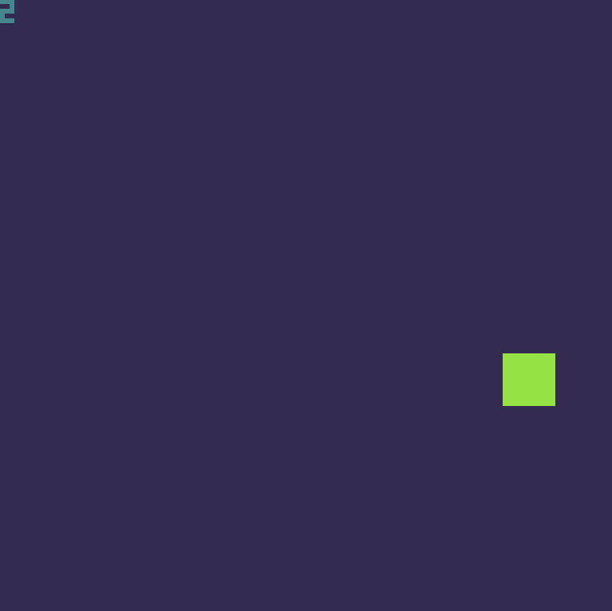

# Odin-4 Fantasy Console

A custom fantasy console built from scratch using the **Odin** programming language, featuring **Raylib** for rendering and **Lua 5.4** for game scripting.

## 🖥️ Window Controls

Resize the console window while playing:

| Key | Action |
| :---: | :--- |
| **1** | Make the window smaller |
| **2** | Make the window bigger |

## 🛠️ Technical Specifications

| Feature | Spec | Details |
| --- | --- | --- |
| **CPU / Scripting** | Lua 5.4 | Standardized at 60 FPS|
| **Display** | 80 × 64 pixels | Low-res retro canvas with a 2-bit color palette (4 colors) |
| **Memory** | 16 KB RAM | User-accessible memory space via custom `peek` and `poke` APIs |
| **Input** | 6 Buttons | **Arrows**, **Z** (Button A), **X** (Button B) |
| **Audio** | 2 Channels | Dedicated Pulse wave and Noise wave sound channels |
| **Sprites** | 128 Sprites | 8×8 pixel sprites with 8 metadata flags per sprite (1 byte) |
| **Tilemap** | 40 × 20 Grid | Built-in background tilemap support |

## 🎨 Built-in Editor Suite

Odin-4 includes custom-built companion tools tailored specifically for the console:

* **Sprite Editor:** Design and manage your 8×8 tiles and configure custom flags.
* **Tilemap Editor:** Paint levels and assemble backgrounds directly for the console's rendering pipeline.

## 🚀 Workflow: Exporting & Running Games

### 1. Exporting a Game

Package your project files into a standalone `.cart` file:

* Drag and drop your game folder directly onto **`Odin 4 Export Tool.exe`**.

### 2. Running a Game

Launch and play your compiled cartridges:

* Drag and drop the resulting **`.cart`** file into the Odin-4 console executable.

## 🎨 Color Palettes

Odin-4 supports dynamic 2-bit (4-color) palette switching via `set_palette(id)`. The console includes the following built-in themes:

| ID | Palette Name | Style / Vibe | Lospec Link |
| :---: | :--- | :--- | :--- |
| **0** | **RGR Blueprint 4** *(Default)* | Blueprint & Commodore 64 inspired | [View on Lospec](https://lospec.com/palette-list/rgr-blueprint4) |
| **1** | **Kirokaze Gameboy** | Classic handheld green-scale nostalgic aesthetic | [View on Lospec](https://lospec.com/palette-list/kirokaze-gameboy) |
| **2** | **Luminous** | High-contrast, vibrant cyberpunk glow | [View on Lospec](https://lospec.com/palette-list/luminous) |
| **3** | **2-Bit Grayscale** | Classic monochrome retro computing shade | [View on Lospec](https://lospec.com/palette-list/2-bit-grayscale) |

## 📖 Lua Scripting API Reference

Odin-4 exposes a lightweight built-in API for game scripting. All functions are categorized below:

### 🎨 Graphics
| Function | Parameters | Description |
| :--- | :--- | :--- |
| `cls` | `(color)` | Clears the screen with a 2-bit palette index (`0-3`). |
| `set_palette` | `(id)` | Sets active theme (`0`: Blueprint, `1`: Gameboy, `2`: Luminous, `3`: Grayscale). |
| `pset` | `(x, y, color)` | Draws a single pixel at the specified coordinate. |
| `rect` | `(x0, y0, x1, y1, color)` | Draws an outlined rectangle (inclusive coordinates). |
| `rectfill` | `(x0, y0, x1, y1, color)` | Draws a filled rectangle (inclusive coordinates). |
| `spr` | `(sprite_id, x, y, flip_x?, flip_y?)` | Draws an 8×8 sprite (`0-127`), color `0` is transparent. |
| `map` | `(cell_x, cell_y, screen_x, screen_y, w, h)` | Renders a section of the 40×25 tilemap. |
| `text` | `(str, x, y, color)` | Draws text using the built-in 3×5 font (auto uppercase). |

### 🕹️ Input
| Function | Parameters | Description |
| :--- | :--- | :--- |
| `btn` | `(id)` | Returns `true` if button is down. IDs: `0` (Right), `1` (Left), `2` (Up), `3` (Down), `4` (Button A / Z), `5` (Button B / X). |

### ⚙️ System & Memory
| Function | Parameters | Description |
| :--- | :--- | :--- |
| `frame_count` | `()` | Returns current frame counter (`0` to `255`). |
| `peek` | `(address)` | Reads a byte from user-accessible memory (`0-255`). |
| `poke` | `(address, value)` | Writes a byte value to user-accessible memory. |
| `check_flag` | `(sprite_id, flag)` | Checks whether a sprite metadata flag (`0-7`) is enabled (`0` or `1`). |

### 🎵 Audio
| Function | Parameters | Description |
| :--- | :--- | :--- |
| `sfx_ch1` | `(freq, vol, duration, slide, duty)` | Plays a pulse wave sound effect on audio channel 1. |
| `sfx_ch2` | `(freq, vol, duration)` | Plays a noise wave sound effect on audio channel 2. |
| `sfx_stop` | `(channel)` | Stops sound playback on the specified channel (`1` or `2`). |

## 🎬 In Action

Here is a quick look at an example application running on the Odin-4 console:

  

